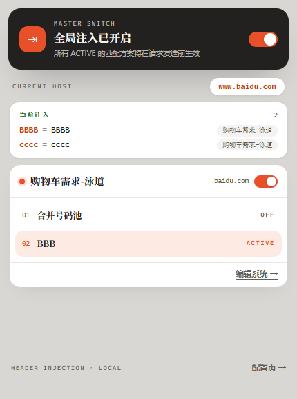
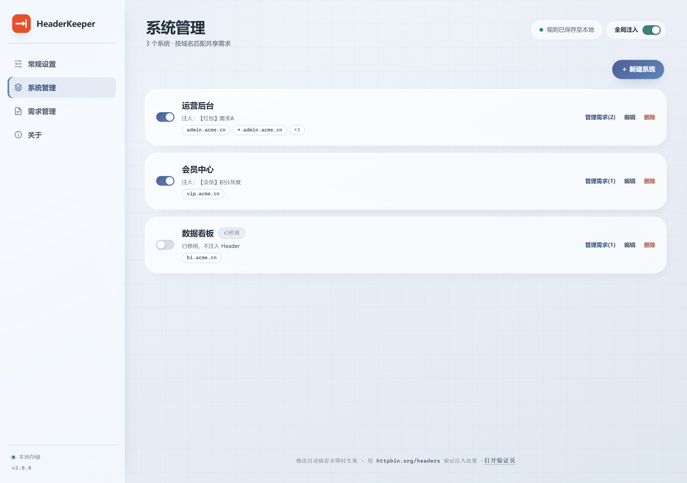
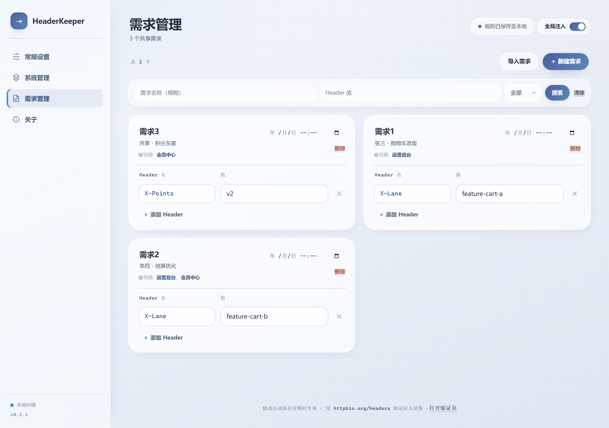
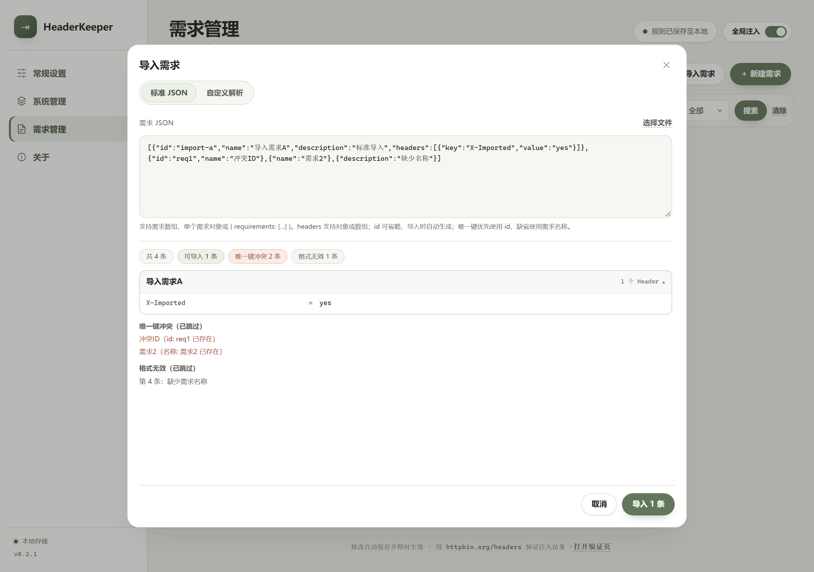

# HeaderKeeper · Header 注入助手

基于 [WXT](https://wxt.dev) + React + TypeScript 的浏览器插件（Chrome Manifest V3）：**按域名匹配「系统」，系统引用共享需求库中的「需求」，在弹窗中一键切换，重写请求 Header**。适用于泳道测试 / 灰度发布 / 多需求并行开发。

<p>
  
  
  
  
  
</p>



## 功能

- **系统与共享需求**：系统按域名匹配（支持 `*.example.com` 通配，命中本域及全部子域名），引用共享需求库中的需求；一个需求可被多个系统复用，改一处全局同步。
- **一键切换**：弹窗「系统」Tab 点选需求即整体应用，再点取消；每个系统至多一个「使用中」需求，右上角总开关可一键关闭全部注入。
- **过期时间**：需求可设过期时间，到期自动停止注入并从弹窗隐藏，默认视图只展示未过期需求。
- **冲突提醒**：多个系统注入同一 Header Key、或同一需求内重复 Key 时，弹窗会提示；重复 Key 注入时保留最后一个。
- **需求导入**：支持标准 JSON（`id` 与名称都参与唯一性校验，冲突自动跳过），也可写一段 JS 在隔离沙箱中把任意 JSON 转成标准格式，解析代码可保存复用。
- **配置管理**：配置（含解析代码）整体导出 / 导入；界面语言中英可切，主题支持浅色 / 深色 / 跟随系统。
- **细节**：修改自动保存即时生效；角标显示当前站点生效的 Header 数量；删除系统 / 需求均有确认弹窗。







## 安装

从 [Releases](https://github.com/handsometaoa/HeaderKeeper/releases) 下载最新 `*-chrome.zip` 解压，在 Chrome / Edge 的「扩展管理」页开启「开发者模式」→「加载已解压的扩展程序」→ 选择解压后的目录。

> 验证注入是否生效：DNR 注入的 Header 在 DevTools 的 Network 面板不一定可见，建议访问 [httpbin.org/headers](https://httpbin.org/headers) 查看服务端实际收到的请求头，或运行 `npm run verify:net`。

## 开发

```bash
npm install
npm run dev        # 开发模式
npm test           # lib/ 纯函数单元测试
npm run build      # 生产构建 → .output/chrome-mv3
npm run zip        # 打包发布 zip
npm run smoke      # 端到端冒烟测试（自动探测系统 Chrome，可用 CHROME_PATH 覆盖）
```

```
entrypoints/              # WXT 入口（background / popup / options）
lib/                      # 领域模型与纯逻辑（类型 / 域名匹配 / DNR 规则 / 导入校验 / i18n）
services/                 # 浏览器平台服务（存储 / DNR 同步 / 角标）
components/ hooks/        # 共享组件与 React hooks
styles/                   # 共享样式（设计令牌，含深色主题）
scripts/                  # 图标生成、冒烟测试（scripts/smoke/）、网络验证
tests/unit/               # vitest 单元测试
```

## 说明与限制

- 使用 `declarativeNetRequest` 的 `modifyHeaders`，需 `<all_urls>` host 权限；面向本地 / 内网测试，请勿发布到应用商店。
- 多个系统命中同一域名且写入同名 Header 时，**靠下的系统覆盖靠上的**（弹窗冲突提示会指出）。
- 旧版配置（`systems[].schemes` 结构）不做迁移：首次加载会自动备份到 `laneConfigLegacyBackup` 后重置。
- Firefox 使用 `npm run build:firefox` 构建（Firefox 113+）。

## 发布

更新 `package.json` 的 `version` → 提交推送 → 打 tag 并推送（`git tag v2.0.1 && git push origin v2.0.1`），GitHub Actions 会自动构建并创建 Release。

## 作者

- GitHub：<https://github.com/handsometaoa>
- 问题反馈：<https://github.com/handsometaoa/HeaderKeeper/issues>

如果这个工具对你有帮助，欢迎点个 Star ⭐

## License

MIT
